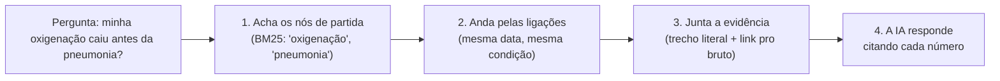
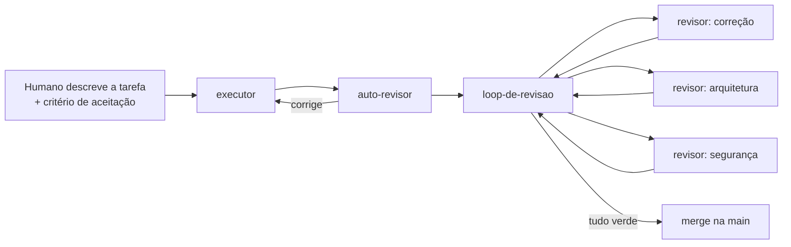

# LIA: hub de saúde pessoal

Projeto para o **Hackathon Gama House · Desafio Rivio** (AI Build Week, novembro de 2026).

Um **health-brain**: junta exames (imagens/pdfs) e dados de wearables numa linha do tempo ligada, que a pessoa consulta em linguagem natural e compartilha com o médico mediante consentimento. Todo número aponta para a fonte.

- Produto: [docs/product-specs/health-brain.md](docs/product-specs/health-brain.md)
- Arquitetura: [ARCHITECTURE.md](ARCHITECTURE.md)
- Plano até a demo: [docs/exec-plans/active/2026-11-14-demo.md](docs/exec-plans/active/2026-11-14-demo.md)

## A ideia: um brain, não uma pasta

Uma pasta de PDFs guarda exames. Um brain **entende** os exames: cada resultado vira uma nota ligada às outras por data, tipo de exame, médico, sintoma e condição. Com isso dá pra perguntar coisas que nenhum PDF responde sozinho:

- "Como meu colesterol mudou nos últimos 2 anos?"
- "Minha oxigenação caiu antes daquela pneumonia?"

Duas ideias sustentam isso: o **LLM Wiki** (como o brain é construído) e o **GraphRAG** (como o brain responde).

### LLM Wiki: a IA mantém, a pessoa decide

O padrão LLM Wiki, proposto por Andrej Karpathy, troca o "joga tudo num chat e pergunta" por uma **wiki que a IA compila e mantém**. A IA faz a contabilidade (ler, resumir, ligar, deduplicar, atualizar). A pessoa faz a curadoria. O conhecimento se acumula, em vez de ser refeito do zero a cada pergunta.

No LIA são três camadas:

| Camada | O que é | Regra |
|---|---|---|
| **Bruto** | O arquivo original: PDF do laboratório, foto do exame em papel, export do relógio | **Nunca muda.** É a prova de tudo |
| **Notas** | Um registro por resultado (exame, valor, unidade, faixa de referência, data, laboratório) com o link pro bruto e o **trecho literal** de onde o valor saiu | Escritas pela IA, validadas por script antes de gravar |
| **Ligações** | Data, tipo de exame, médico, sintoma e condição | A linha do tempo é a visão ordenada dessas ligações |

Quando chega um exame novo, a IA não cria uma pilha a mais: ela **atualiza o brain**. O mesmo exame com nome diferente em dois laboratórios ("LDL-Colesterol" e "Colesterol LDL") vira uma série só. Novas leituras do relógio se ligam aos exames da mesma época.

### GraphRAG: responder andando pelas ligações, sempre com fonte

RAG é buscar o contexto certo antes de a IA responder. **GraphRAG** é fazer essa busca **andando pelas ligações** entre as notas, em vez de só procurar texto parecido. O LIA faz isso **sem banco vetorial**: as ligações vêm do próprio modelo de notas, e a busca usa BM25 (ranking clássico por palavra) e busca literal.

Por que assim:

- **Toda resposta tem fonte.** Sem trecho literal ligado ao original, o número não aparece. O médico confere em um clique.
- **Dá pra auditar.** O caminho da resposta é feito de notas e ligações que qualquer pessoa consegue abrir, não de vetores opacos.
- **É simples de rodar.** Sem infraestrutura extra, o que importa numa semana de hackathon.

A referência dessas duas ideias é o Jarvis, um segundo cérebro de trabalho que já usa LLM Wiki e GraphRAG sem embeddings. O que o LIA aproveita dele está em [inspiracao/README.md](inspiracao/README.md#o-que-dá-pra-levar-pro-lia).

## Como o código é escrito

Este repo segue o [harness engineering](https://openai.com/pt-BR/index/harness-engineering/): **humano dirige, agente executa**. Quem escreve, revisa e mescla o código são agentes de IA. O trabalho do time é cuidar do **ambiente** em que eles trabalham: docs, regras, lint e ferramentas.

### Os princípios

1. **O repositório é a fonte da verdade.** Se não está no repo, o agente não sabe. Decisão tomada no chat ou na reunião vira doc.
2. **O `AGENTS.md` é um mapa, não um manual.** Tem ~100 linhas e aponta para onde está cada coisa. O detalhe mora em `docs/`, que o agente lê só quando a tarefa pede.
3. **Regra que importa vira checagem.** Camadas, segurança e "todo número tem fonte" são conferidos por lint, teste ou revisor, não pela boa vontade de quem escreve.
4. **Quando o agente erra, a gente melhora o repo, não o código.** A pergunta é sempre "o que faltou pra ele acertar?": um doc, uma regra, uma ferramenta. Agente travou duas vezes no mesmo ponto: para, melhora o repo, tenta de novo.
5. **Doc errado é pior que doc faltando.** O agente acredita no que lê; por isso tem um agente só pra manter os docs verdadeiros.

### Onde está cada coisa

| O quê | Onde |
|---|---|
| Ponto de entrada dos agentes | [AGENTS.md](AGENTS.md) |
| Domínios, camadas e regra de dependência | [ARCHITECTURE.md](ARCHITECTURE.md) |
| Princípios que não se negociam (privacidade, fonte) | [docs/design-docs/core-beliefs.md](docs/design-docs/core-beliefs.md) |
| O que está sendo feito agora e as decisões | [docs/exec-plans/active/](docs/exec-plans/active/) |
| Nota de qualidade por domínio | [docs/QUALITY_SCORE.md](docs/QUALITY_SCORE.md) |
| Os agentes e o fluxo entre eles | [docs/agents.md](docs/agents.md) e o guia completo em [.claude/agents/README.md](.claude/agents/README.md) |

### Os 8 agentes

| Agente | Papel | Quando |
|---|---|---|
| `fundador` | Monta o esqueleto: domínios, camadas, CI, lint de camadas | Uma vez, ao escolher a stack |
| `executor` | Implementa a tarefa de ponta a ponta e abre o PR | A cada tarefa |
| `auto-revisor` | Revisa o próprio diff antes de pedir revisão (não edita) | Logo depois de implementar |
| `revisor` | Revisa o PR com um foco: correção, arquitetura, segurança, testes ou performance | Vários em paralelo |
| `loop-de-revisao` | Leva o PR até o fim: revisão, correção e CI até aprovar; depois mescla | Com o PR aberto |
| `jardineiro-de-docs` | Corrige doc que não bate com o código | Toda noite |
| `coletor-de-lixo` | Faxina de padrões ruins e dívida técnica | Toda quinta |
| `ponta-a-ponta` | Reproduz, corrige, prova, abre o PR e mescla com um comando | Com o repo maduro |

### O fluxo de uma tarefa

Exemplo de pedido:

> usa o executor pra fazer a extração de PDF do domínio exames: cada resultado vira nota com valor, unidade, faixa de referência, data e link pro original. Depois leva o PR até o fim com o loop-de-revisao

Cada trilha do time trabalha numa **worktree própria**, com sua instância do app, então as trilhas andam em paralelo sem pisar uma na outra. A integração na `main` é diária, e o repo fica sempre verde.

### Segurança

O repositório é **público** e o tema é saúde. Por isso:

- O `revisor` com foco em **segurança** roda em todo PR que mexe em upload, armazenamento, consentimento ou chamada de IA.
- Chave de API, token e `.env` nunca entram no git (`.env.example` vai sem valor).

## Dados

Só dados **sintéticos** entram no repositório (`data/sintetico/`). Dado de saúde real nunca é commitado.
